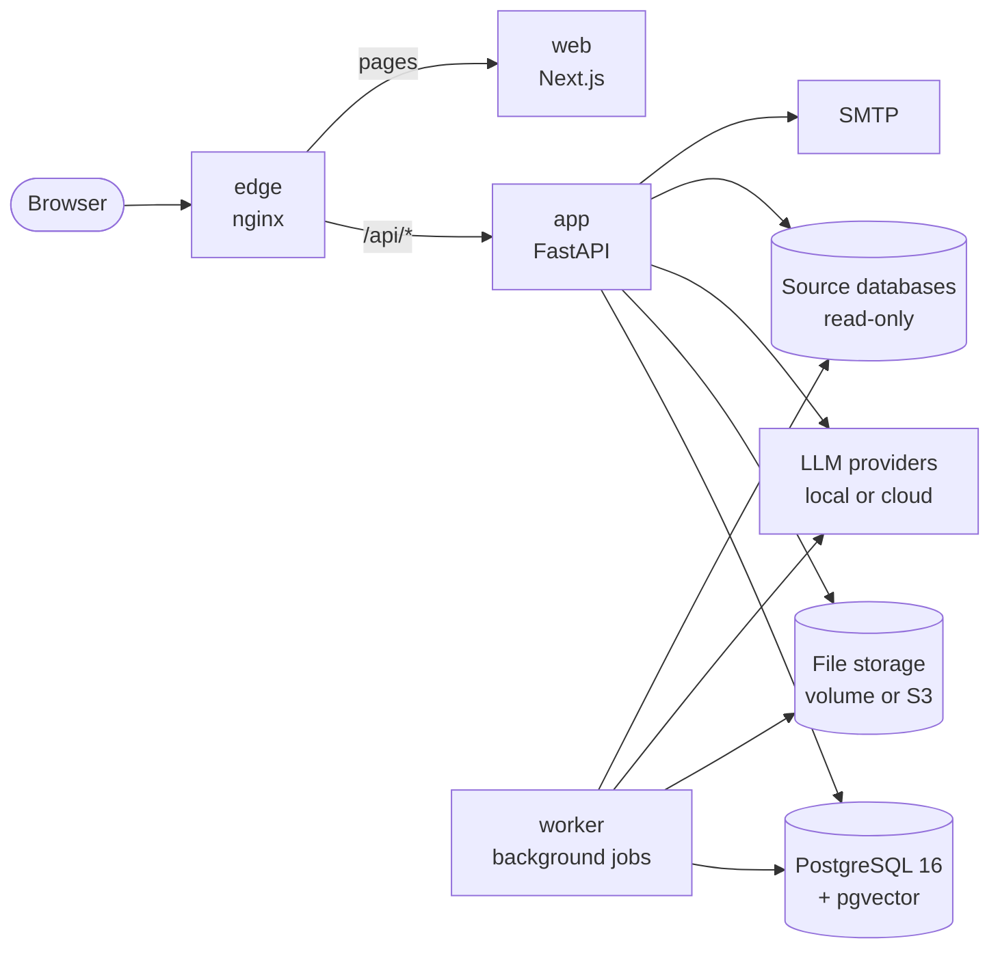

<div align="center">

# DAWAM

**Data Analysis & Warehouse Architecture Modeler**

Analyse your source systems and design your data warehouse in one place, with every
design decision traceable to the real source schema and an AI assistant at each step.

[](https://github.com/EslamAlaaZaki/dawam/actions/workflows/ci.yml)
[](LICENSE)


[Quick start](#quick-start) · [Use cases](#use-cases) · [Features](#features) ·
[AI providers](#ai-providers) · [Deployment](deploy/README.md) · [Documentation](#documentation) ·
[Contributing](CONTRIBUTING.md)

</div>

---

> **Status:** under active development toward Release 1. Expect changes to features and
> the API between versions.

## Why DAWAM

Building a data warehouse usually means the same disconnected sequence on every project:

1. **Source analysis by hand.** You explore tables, guess relationships that were never
   declared as foreign keys, and dig through scattered documentation.
2. **Design in drawings and documents** that drift out of date as soon as they are written.
3. **Mapping sheets in Excel**, the contract between analyst and engineer, with no
   validation and no link to the actual source schema.
4. **Lineage in people's heads.** When a source changes, nobody knows which mappings and
   KPIs are affected.

DAWAM keeps all of this in one self-hosted web application. Each Workspace holds your
source systems and one data warehouse design. Every table, mapping and KPI stays linked
to the real source schema, and every change, whether from a person, the AI or a schema
sync, arrives as a reviewable **Change Set**.

## Use cases

| You want to… | How DAWAM helps |
|--------------|-----------------|
| **Understand an undocumented source system** | Connect to the database (or import its schema from files), profile the data, discover undeclared relationships, and let the AI draft table descriptions, labels and a gaps report. |
| **Find personal data before it reaches the warehouse** | Scan column names and sampled values with Arabic and English PII rules (Saudi-focused, PDPL-aware), review the findings, and follow PII through lineage into the warehouse. |
| **Define what the business needs** | Build a KPI catalog per source system or for the whole warehouse, with AI-suggested KPIs based on the source analysis. |
| **Design a Kimball warehouse** | Generate staging automatically, have the AI propose Core and Mart models (facts, dimensions, grain, SCD types) from your sources and KPIs, then edit everything. |
| **Replace mapping spreadsheets** | Maintain validated source-to-target mappings per layer, always linked to real columns. |
| **Answer "where does this number come from?"** | Trace lineage from any KPI or warehouse column back to its source columns. |
| **Handle source schema changes safely** | Re-sync a source, see every affected Asset, and apply the propagated changes as a Change Set you accept in full or in part. |
| **Check design quality** | Get a rule-based score per warehouse, layer and table, with fix hints and an approval gate per layer, plus an advisory AI evaluation. |
| **Hand over to engineering** | Export DDL and design documentation from the finished model. |
| **Work in a restricted environment** | Run fully air-gapped with self-hosted models (Ollama, vLLM, SGLang); nothing has to leave your network. |

## Features

DAWAM follows the stages of a warehouse project:

| Stage | What happens | Outputs |
|-------|--------------|---------|
| **1. Source System Analysis** | Live Connections or Schema Import, Snapshots, profiling, relationship discovery, PII detection, documents | Enhanced Source Schema, profiles, PII findings, documentation |
| **2. KPIs** | User-entered and AI-suggested KPIs | KPI catalog |
| **3. DW Modeling** | Generated staging; AI-assisted Core and Mart; mappings per layer; scoring and evaluation | DW Schema, mappings, scores, lineage, DDL |
| **4. DW Implementation** *(next phase)* | Turn mappings into implementation artifacts | dbt skeleton, SQL transforms, load-order plan |

Across all stages:

- **AI assistant.** An agentic chat in every Workspace that explores sources using real
  schema, statistics and data rather than guesses. It runs on any model: OpenAI-compatible
  servers (Ollama, vLLM, SGLang, OpenAI), Anthropic, Azure OpenAI, Gemini or AWS Bedrock.
- **Nothing changes silently.** AI output, regenerations, syncs and propagated changes all
  arrive as Change Sets. Fields you override are remembered and never silently undone.
- **Collaboration.** Workspaces with Owner, Editor and Viewer roles, invitations, activity,
  notifications and an audit trail.
- **Source engines.** Live connections to PostgreSQL, SQL Server, MySQL/MariaDB and Oracle.
  Schema Import from files works without a connection, with helper queries for those
  engines plus IBM Db2 and Teradata. The warehouse can target PostgreSQL, SQL Server,
  Oracle, Snowflake or BigQuery.
- **Security built in.** Credentials encrypted with AES-256-GCM, database-backed sessions,
  CSRF protection, account lockout and rate limiting, a strict Content-Security-Policy, and
  a security event log. Details are in [`docs/reference.md`](docs/reference.md).

## AI providers

Add a provider in **Admin > Language models** and pick its **Type**. Then add its models
there, and assign them to roles in **Admin > Roles, budgets & usage**:

| Type | Covers | Base URL | API key field | Model name | Embeddings |
|------|--------|----------|---------------|------------|------------|
| **OpenAI-compatible** (`openai_compatible`) | OpenAI, OpenRouter, Groq, Together, Mistral, DeepSeek, vLLM, SGLang, Ollama, LM Studio, llama.cpp server, and any server with `/v1/chat/completions` | e.g. `https://api.openai.com/v1`, `http://ollama:11434/v1` | Optional (local servers often need none) | Picked from the live `/v1/models` list | Yes, via `/v1/embeddings` |
| **Anthropic (Claude)** (`anthropic`) | Claude through the Anthropic API | `https://api.anthropic.com/v1` | Anthropic API key | Picked from the live list | No |
| **Azure OpenAI** (`azure_openai`) | Azure OpenAI deployments | Resource endpoint `https://<res>.openai.azure.com`, optionally with `?api-version=...` | Azure key, or `entra:<tenant_id>:<client_id>:<client_secret>` for Entra ID | Deployment name, typed in | Yes, with an embedding deployment |
| **Google Gemini (API or Vertex AI)** (`gemini`) | Gemini API (Google AI Studio keys) and Vertex AI | Gemini API: `https://generativelanguage.googleapis.com/v1beta`; Vertex AI: `https://<region>-aiplatform.googleapis.com/v1/projects/<P>/locations/<L>/publishers/google` | AI Studio API key, or a service account's whole JSON key | Picked from the live list (Gemini API); typed in (Vertex AI) | Yes (Gemini API) |
| **AWS Bedrock** (`bedrock`) | Models on Bedrock (Converse API) | Regional runtime endpoint, e.g. `https://bedrock-runtime.us-east-1.amazonaws.com` | `<access key id>:<secret>[:<session token>]`, optionally followed by `;role=<role ARN>` | Picked from the foundation-model and inference-profile list; you enter the context window | No |

- **Where it runs.** Mark cloud services **External** and only self-hosted servers
  **Internal**: internal-only Workspaces accept internal providers only.
- **Document search needs an embedding model.** If your agent model's provider can't
  embed (Anthropic, Bedrock), add a second provider for the Embedding role, such as
  OpenAI, Gemini or a local Ollama embedding model.
- **More providers** can ship as separate Python packages through the
  `dawam.llm_providers` entry point, without changing the core.

[`docs/install.md`](docs/install.md) has tested recipes for local LLM servers.

## Architecture



| Layer | Technology |
|-------|-----------|
| Frontend | Next.js (App Router), React, TypeScript, TanStack Query, generated OpenAPI client |
| Backend | Python 3.12, FastAPI, SQLAlchemy 2, Alembic, a modular monolith |
| Storage | PostgreSQL 16 with pgvector; files on a local volume or S3-compatible storage |
| Delivery | Docker Compose with nginx as the single entry point |

[`deploy/README.md`](deploy/README.md#components) describes every component and the
network access each one needs.

## Quick start

You need **Docker** with **Compose v2.24+**.

```sh
git clone https://github.com/EslamAlaaZaki/dawam.git
cd dawam
cp .env.example .env
```

Edit `.env` and set at least these values:

```sh
DAWAM_ENCRYPTION_KEY=<output of: openssl rand -base64 32>   # required; back it up
DAWAM_ADMIN_EMAIL=admin@example.com                         # first admin, created on first start
DAWAM_ADMIN_PASSWORD=<at least 10 characters>
```

Then start DAWAM:

```sh
docker compose up -d --build
```

Open **<http://localhost:8000>** and sign in. To use AI features, add a model in
**Admin > Language models**.

**Want everything at once?** The all-in-one file also starts a local LLM (Ollama, with
models pulled automatically), a mail catcher and a demo source database:

```sh
docker compose -f deploy/docker-compose.yaml --env-file .env --profile demo up -d --build
```

## Deployment

| Option | Best for | Guide |
|--------|----------|-------|
| Docker Compose | Evaluation and single-server installs | [Method 1](deploy/README.md#1-docker-compose) |
| All-in-one Compose file | Trying every feature, including a local LLM and demo data | [Method 2](deploy/README.md#2-all-in-one-compose-file) |
| Local development | Working on the code with hot reload | [Method 3](deploy/README.md#3-local-development) |
| Local run without Docker | Running the built app directly on your machine | [Method 4](deploy/README.md#4-local-run-without-docker) |
| Linux server with systemd | Hosts where containers are not allowed | [Method 5](deploy/README.md#5-linux-server-without-docker-systemd) |

All settings are environment variables, documented in [`.env.example`](.env.example).
Only `DAWAM_ENCRYPTION_KEY` is required.

## Documentation

| Document | What's in it |
|----------|--------------|
| [`deploy/README.md`](deploy/README.md) | Deployment methods, components and the production checklist |
| [`docs/install.md`](docs/install.md) | Configuration, local LLM servers, air-gapped installation |
| [`docs/configuration.md`](docs/configuration.md) | Every setting with its default, and how each Compose service gets it |
| [`docs/operations.md`](docs/operations.md) | Backups, upgrades, key rotation, monitoring, troubleshooting |
| [`docs/reference.md`](docs/reference.md) | Accounts, security controls, email, Workspaces, files and their API endpoints |
| [`docs/spec.md`](docs/spec.md) | The full product specification (large; search it by heading) |
| [`docs/ai-architecture.md`](docs/ai-architecture.md) | How the AI side works today: gateway, agent loop, tools, RAG, safety |
| [`docs/ai-enhancements.md`](docs/ai-enhancements.md) | The AI roadmap and the status of each item |
| [`DESIGN.md`](DESIGN.md) | The UI design system |
| [`CONTEXT.md`](CONTEXT.md) | The domain glossary: Workspace, Source System, Snapshot, Change Set… |
| [`docs/adr/`](docs/adr/) | Architecture decision records |
| [`samples/bank/README.md`](samples/bank/README.md) | A ready-to-run bank demo (Core Banking on PostgreSQL, CRM on MySQL, documents, KPIs) with a step-by-step demo script |
| [`samples/retail/README.md`](samples/retail/README.md) | The same for retail (POS on PostgreSQL, e-commerce on MySQL) |
| [`CONTRIBUTING.md`](CONTRIBUTING.md) | Development setup, conventions, tests and the pull request process |

The API is documented live at `/api/v1/docs`, and its OpenAPI spec is at
`/api/v1/openapi.json`.

## Contributing

Contributions are welcome. [`CONTRIBUTING.md`](CONTRIBUTING.md) covers setting up the
development environment, running the tests and opening a pull request. Bugs and feature
requests go in [GitHub Issues](https://github.com/EslamAlaaZaki/dawam/issues).

## License

DAWAM is licensed under the [Apache License 2.0](LICENSE).
