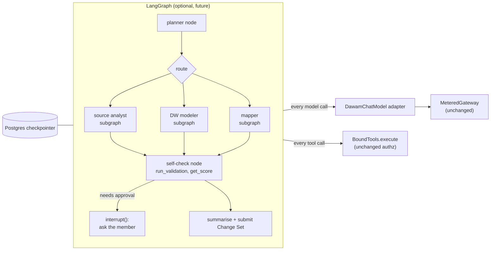
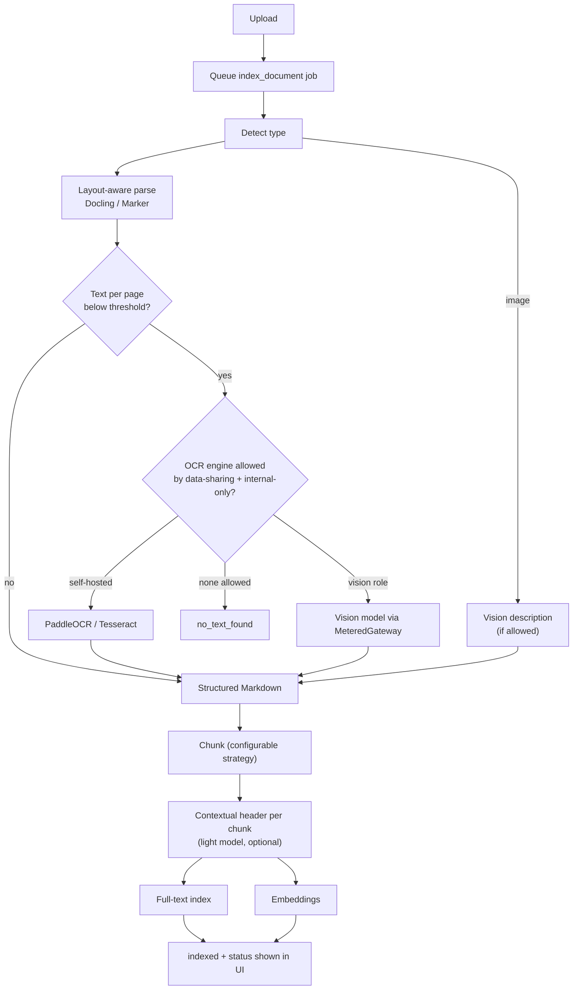
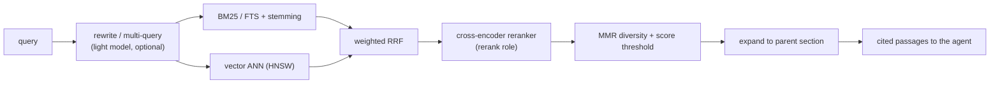
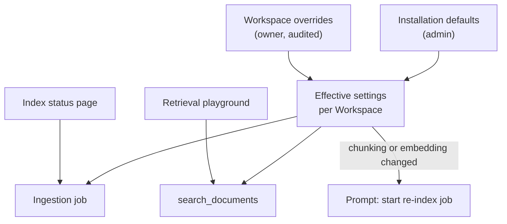
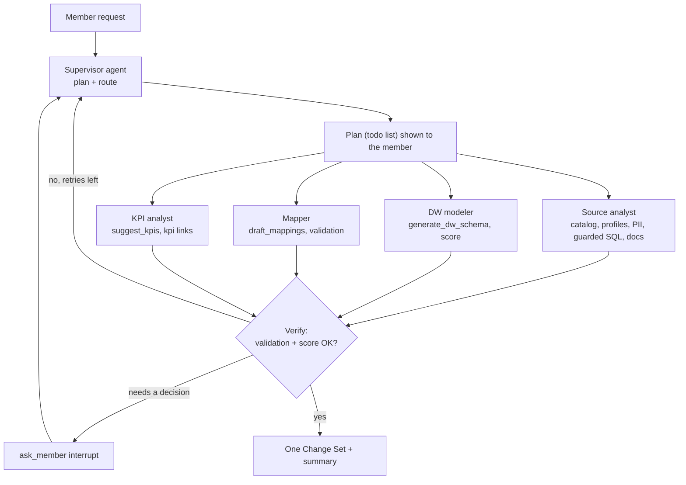
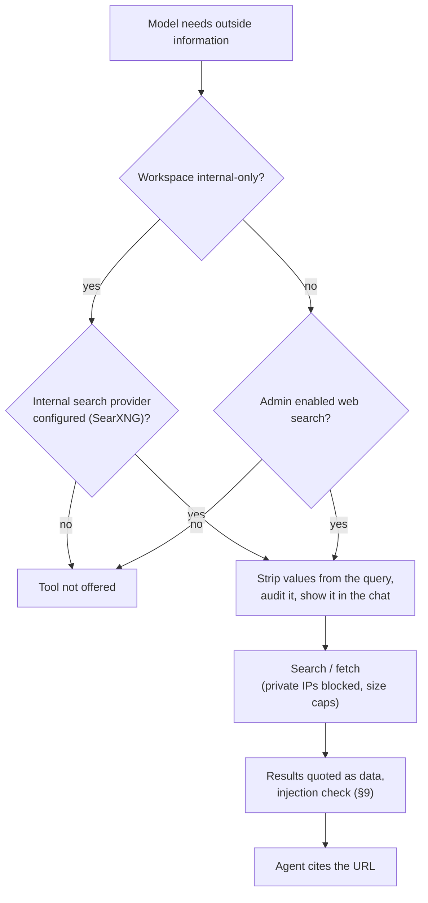
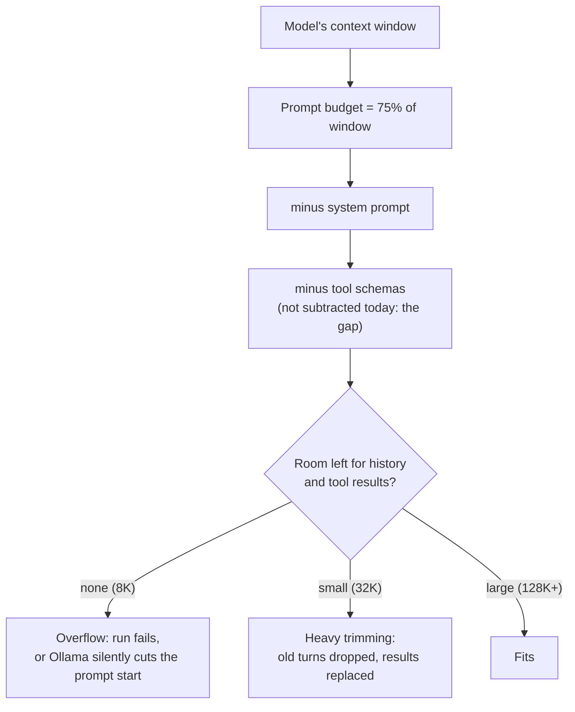
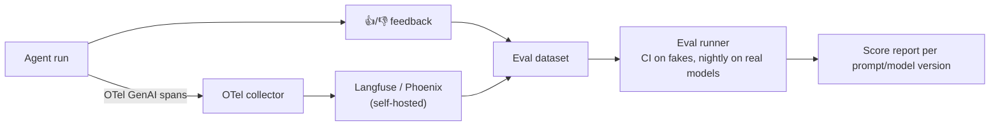
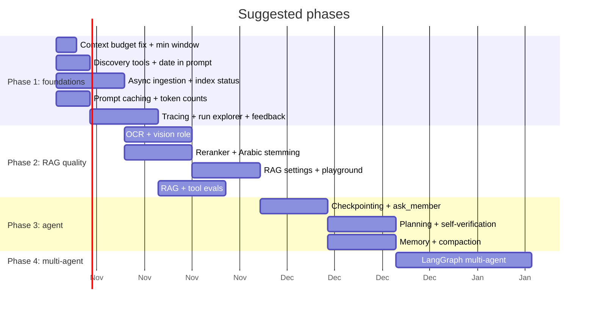

# DAWAM AI enhancements roadmap

What could make DAWAM's AI side a modern agentic system, based on what the code does today (see `docs/ai-architecture.md`). Each item says **what's missing today**, **what to build**, **options** and **trade-offs**. The prioritised plan is at the end (§11).

> These are proposals, not decisions. Several touch existing decisions (ADR 0002 on source data, ADR 0005 on embedding models, the "no vendor SDK" gateway design), so each one needs its own ticket and, where it changes a decision, an ADR.

---

## 0. Guiding principles

Today's design has strengths worth keeping whatever we adopt:

1. **One gateway for every model call.** Budgets, internal-only, usage tracking, retries and redaction live there. Nothing new may call a provider directly, including LangChain or LangGraph integrations.
2. **Tools run as the member, through the service layer.** Every tool call is authorized server-side. Any new orchestrator must call `BoundTools.execute`, never the services directly.
3. **Data-sharing levels and internal-only apply to every new model call**: OCR via vision models, rerankers, summarizers and guard models included.
4. **Humans approve writes** through Change Sets.
5. **Untrusted text is quoted data.** New sources (OCR text, image descriptions, memory) are quoted too.

---

## 1. Orchestration: LangGraph, LangChain or our own loop?

### Today
A hand-written single-agent loop (`assistant/internal/agent.py`). It works, it's small, tested and provider-neutral, but it lacks:

- **durable state**: a job whose worker dies starts from zero and its progress is lost;
- **mid-run human approval** (pause, ask, resume);
- **planning** and **multi-agent** structure;
- **graph-level observability** (which step, which branch, how long).

### Options

| Option | What it gives | Costs and risks |
|---|---|---|
| **A. LangGraph** | `StateGraph` with nodes and edges; Postgres checkpointer (`langgraph-checkpoint-postgres`) for durable, resumable runs; `interrupt()` for human-in-the-loop; subgraphs for multi-agent; time travel and replay; token and event streaming | New dependency tree; its own message types; must not use LangChain provider integrations (they'd bypass the gateway); a learning curve for the team; version churn |
| **B. LangChain only** (no LangGraph) | Document loaders, text splitters, retrievers, rerankers | Little value for us: our gateway, tools and retrieval are already done, and LangChain's agent executor is superseded by LangGraph. **Not recommended on its own.** |
| **C. Extend our own loop** | Add checkpointing (save `messages` after each step in a `run_steps` table), an `ask_member` interrupt, a planner step, sub-agents as tools | We maintain it; we re-build what LangGraph gives |
| **D. Other frameworks** | PydanticAI (typed, light, fits our Pydantic tools), OpenAI Agents SDK, Microsoft Agent Framework / Semantic Kernel, CrewAI, LlamaIndex Workflows | Same "don't bypass the gateway" constraint; CrewAI/AutoGen add multi-agent chat styles we probably don't need |

### Recommendation

- **Short term: C.** Add checkpointing and interrupts to our loop; it's the smallest change with the biggest win for long jobs.
- **When we need multi-agent, planning graphs or complex HITL: A (LangGraph), adopted carefully:**
  - Wrap our `Gateway` / `MeteredGateway` as a LangChain `BaseChatModel` (and an `Embeddings` class), so every call still goes through budgets, internal-only and usage.
  - Wrap each bound tool as a `StructuredTool` whose function is `BoundTools.execute(name, args)`, so authorization and data-sharing checks stay.
  - Use the Postgres checkpointer on our own database.
  - Keep quoting tool results as `<data>` blocks inside the graph.
  - Migrate jobs first (they benefit most from durability), then chat.

---

## 2. Document ingestion: OCR, layout and images

### Today
Shipped in Epic 21 (#363, #424, #425, #364, #426): indexing runs as a background job with a per-file status; PDF, DOCX and XLSX are parsed by Docling into Markdown that keeps headings and tables; scanned PDF pages are read by OCR (a self-hosted Docling + RapidOCR engine, or the Workspace's vision model); uploaded images are described by the vision model; the agent has a `describe_image` tool. How it works now: `ai-architecture.md` §8.1. What did not ship: the Document AI settings page (§5), so the parser, OCR engine and thresholds are still environment settings and code constants.

### 2.1 OCR

| Engine | Arabic | Hosting | Notes |
|---|---|---|---|
| **Tesseract** (`ara` + `eng`) | fair | self-hosted, CPU | easiest; weaker on Arabic script and complex layouts |
| **PaddleOCR** (PP-OCR, Arabic model) | good | self-hosted, CPU/GPU | strong multilingual quality |
| **Surya / Marker** | good | self-hosted, GPU preferred | layout + reading order + OCR; Marker outputs Markdown |
| **Docling** (IBM) | via its OCR backends | self-hosted | PDF/DOCX/PPTX/images → structured Markdown with tables; can use EasyOCR/Tesseract/RapidOCR |
| **Azure AI Document Intelligence** | very good | cloud | layout, tables, key-values; external provider |
| **Google Document AI / AWS Textract** | good / limited Arabic | cloud | external |
| **Vision LLM through our gateway** (GPT-4o-class, Claude, Gemini, Qwen2.5-VL, local VLMs via vLLM/Ollama) | very good | either | understands diagrams and tables; costs tokens; must honour the data-sharing level and internal-only |

**Recommendation:** add an `OcrEngine` port in `files/internal/` with two implementations to start: a self-hosted one (PaddleOCR or Docling) for internal-only installs, and a **vision-model** one that calls a new gateway role `vision` (so budgets and internal-only apply). Run OCR only when `pypdf` returns no or very little text per page.

**Done** (#424, #425). The port is `OcrEngine` (`files/internal/ocr.py`). The self-hosted engine is Docling with RapidOCR (PP-OCR models on ONNX Runtime, CPU or NVIDIA GPU), read once per language (English, Arabic) keeping the more confident reading per page; Tesseract and PaddleOCR were not built. The `vision` role is a gateway role like `embedding`, with its own Workspace Model, Test connection and adapter support. OCR runs only on pages with under 50 characters of their own text. RapidOCR stays the self-hosted engine (maintainer decision; the bake-off, #450, was dropped).

### 2.2 Layout-aware parsing
Replace per-page `extract_text()` with a parser that keeps **headings, reading order and tables** (Docling, Marker or Unstructured), output as Markdown. Our heading-based chunker then gets real sections, and tables stay intact as Markdown tables.

**Done** (#364) for PDF, DOCX and XLSX, with Docling. Table-aware chunking and chunk overlap (§3) shipped in Epic 22 (#366, #365).

### 2.3 Images and diagrams
Data teams upload **ERD screenshots, architecture diagrams and report mock-ups**. A vision model can describe them ("table `orders` has FK `customer_id` → `customers.id`") and that description becomes searchable text, linked to the image. A new tool such as `describe_image(file_id)` would let the agent look on demand.

**Done** (#426). An uploaded image is described on indexing and the description is its searchable text; the agent's `describe_image` tool returns it, or asks the vision model afresh when there is none.

### 2.4 Async ingestion
Move `index_file` from the upload request to a job (`index_document`), with a per-file status: `queued → extracting → ocr → chunking → embedding → indexed | failed`. OCR and embeddings are too slow for a request.

**Done** (#363) as the `index_document` job and `files.index_status`, with one extra column, `index_note`, added by #425. The diagram below is the original design; it differs from what shipped in these ways: the self-hosted engine is Docling + RapidOCR, there are no contextual headers, and image descriptions are made at the `ocr` stage. See `ai-architecture.md` §8.1 for the shipped flow.

---

## 3. Chunking and indexing

| Today | Enhancement |
|---|---|
| Fixed ~1,000-char target, 1,500 hard split, no overlap | Configurable size and **overlap**, measured in **tokens** of the embedding model. **Done** ([#365](https://github.com/EslamAlaaZaki/dawam/issues/365)): 250 target, 375 max, 40 overlap, counted with the model's own tokenizer; settings since [#380](https://github.com/EslamAlaaZaki/dawam/issues/380) |
| Heading-based sections only | Strategies: heading-aware (today), recursive, **semantic** (split where embedding similarity drops), table-aware (a table is one chunk, with its header repeated). **Done**: table-aware ([#366](https://github.com/EslamAlaaZaki/dawam/issues/366)); recursive and semantic as a per-Workspace setting ([#367](https://github.com/EslamAlaaZaki/dawam/issues/367)) |
| Chunk = what's retrieved | **Parent/child ("small-to-big")**: embed small chunks, return their parent section to the model. **Done** ([#368](https://github.com/EslamAlaaZaki/dawam/issues/368)): parents of ~1,000 tokens, children of ~250 |
| No chunk context | **Contextual retrieval**: prepend a one-sentence context ("From the Loans data dictionary, section Status codes…"), written by the light model, before embedding and full-text indexing. **Done** ([#369](https://github.com/EslamAlaaZaki/dawam/issues/369)); off without a light model |
| No metadata filters beyond Source System | Metadata per chunk: document type, language, page number, sheet, tags; filterable in the tool. **Done** ([#370](https://github.com/EslamAlaaZaki/dawam/issues/370)); tags are the file's folders |
| No ANN index (vector column has no fixed dimension) | Per-model **partial HNSW indexes** with a fixed-dimension cast (e.g. `CREATE INDEX ... USING hnsw ((embedding::vector(1024)) vector_cosine_ops) WHERE embedding_model_id = '...'`), or `halfvec` to save memory; needed once Workspaces have many documents. **Done** ([#371](https://github.com/EslamAlaaZaki/dawam/issues/371)) with the `vector` cast up to 2,000 dimensions; `halfvec` not built |
| Embedding model fixed after indexing (ADR 0005) | The deferred **re-embed on change** job: build new vectors in the background, search full-text meanwhile, then switch. **Done** ([#372](https://github.com/EslamAlaaZaki/dawam/issues/372), ADR 0006) |
| Generic embedding model | Recommend **multilingual** embedders for Arabic + English (documented in `ai-architecture.md` §8.3): `bge-m3`, `multilingual-e5-large`, `jina-embeddings-v3`, OpenAI `text-embedding-3-large`, Cohere `embed-multilingual-v3` |

---

## 4. Retrieval quality

| Gap today | Enhancement |
|---|---|
| No re-ranking | **Cross-encoder reranker** after fusion: `bge-reranker-v2-m3` (self-hosted, multilingual), Cohere Rerank, Jina Reranker. Add a gateway **`rerank` role** and adapter method so it obeys budgets and internal-only. **Done** ([#373](https://github.com/EslamAlaaZaki/dawam/issues/373)): OpenAI-compatible `/rerank` (Cohere, Jina, vLLM shapes) reorders the fused top 30; the fused order is the fallback |
| `simple` FTS config, no stemming | **Arabic light stemming** (e.g. an ISRI/Tashaphyne-style stemmer applied with the normalisation) and English stemming; or BM25 via `pg_search` (ParadeDB) / `pg_textsearch`. **Done** ([#374](https://github.com/EslamAlaaZaki/dawam/issues/374)): own light Arabic and English stemmers; BM25 not built |
| Plain OR of words | Phrase and proximity matching; boost exact identifier matches (table and column names). **Done** ([#375](https://github.com/EslamAlaaZaki/dawam/issues/375)): adjacent-word phrases and identifiers rank first in `ORDER BY`, and identifier matches stay first after fusion and reranking |
| Equal-weight RRF, fixed k=60, 20 candidates each | Configurable weights, k and candidate counts (admin setting, §5). **Done** ([#376](https://github.com/EslamAlaaZaki/dawam/issues/376)) as `SearchTuning`; now Document AI settings ([#380](https://github.com/EslamAlaaZaki/dawam/issues/380)) |
| One query as typed | **Query rewriting / multi-query** (light model writes 2–3 variants, including Arabic ↔ English), **HyDE** for vague questions. **Done** ([#377](https://github.com/EslamAlaaZaki/dawam/issues/377)): up to 3 variants plus an optional HyDE answer from the light model; off without one |
| No diversity | **MMR** to avoid five passages from the same section. **Done** ([#376](https://github.com/EslamAlaaZaki/dawam/issues/376)) |
| No score threshold | Minimum relevance score; tell the model "nothing relevant found" instead of weak passages. **Done** ([#376](https://github.com/EslamAlaaZaki/dawam/issues/376)): a relevance floor on text rank and cosine similarity, and a "nothing relevant found" note |
| Retrieval only via a tool | Keep that (agentic RAG is right for us), plus an optional **auto-retrieve** of the top 3 passages for the first message. **Done** ([#378](https://github.com/EslamAlaaZaki/dawam/issues/378)): a per-Workspace `auto_retrieve` setting, off by default; no UI toggle (not among the Document AI settings) |
| Documents only | **GraphRAG-style** retrieval over what we already have: lineage graph, relationships, KPI links. A "knowledge graph" tool combining catalog + docs + lineage. **Done** ([#379](https://github.com/EslamAlaaZaki/dawam/issues/379)): the `explore_graph` tool |

---

## 5. Admin settings for the RAG pipeline

### Today
Admins choose providers, models, roles and budgets; owners choose the embedding model and data-sharing level. **Every RAG parameter is a constant in code** (`TARGET_CHARS`, `EMBED_BATCH`, `CANDIDATES`, `RRF_K`, `DEFAULT_LIMIT`, extraction caps).

### Proposal
An **installation-level "Document AI" settings page** (admins) with **per-Workspace overrides** (owners), stored in a settings table, validated, audited and versioned. Changes that invalidate the index (chunking, embedding model) ask to start a re-index.

**Done** ([#380](https://github.com/EslamAlaaZaki/dawam/issues/380), [#381](https://github.com/EslamAlaaZaki/dawam/issues/381), [#382](https://github.com/EslamAlaaZaki/dawam/issues/382), [#383](https://github.com/EslamAlaaZaki/dawam/issues/383)): admin page and Workspace tab, the re-index prompt, the index status panel and the retrieval playground. Built: chunking (strategy, size, overlap, headers), embed batch, extraction caps, retrieval (candidates, weights, k, MMR, floors, top-k) and rerank on/off with top-n. Not built: ingestion toggles (file types, OCR, parser), embedding and HNSW options, query rewriting / HyDE toggles, and the Answering group.

| Group | Settings |
|---|---|
| **Ingestion** | allowed file types; max file size; max pages; OCR on/off; OCR engine (none / Tesseract / PaddleOCR / Docling / vision model); OCR languages (`ara`, `eng`); OCR trigger threshold (chars per page); describe images on/off; parser (pypdf / Docling / Marker) |
| **Chunking** | strategy (heading / recursive / semantic / table-aware); chunk size and overlap (tokens); parent-child on/off; contextual headers on/off (uses the light model) |
| **Embedding** | embedding model (today: per Workspace); batch size; vector type (`vector` / `halfvec`); build HNSW index on/off with `m`, `ef_construction`; query-time `ef_search` |
| **Retrieval** | hybrid on/off; full-text weight vs vector weight; RRF k; candidates per ranking; final top-k; min score; MMR λ; query rewriting on/off; HyDE on/off |
| **Reranking** | reranker model (rerank role); rerank top-n |
| **Answering** | auto-retrieve on first message; max passages in context; citation style |
| **Operations** | re-index Workspace / file; index status dashboard |

Plus two pages:

- **Index status**: per file, its status (queued / indexed / OCR'd / failed), chunk count, embedding coverage, stale vectors (old model), last error; buttons to re-index one file or all.
- **Retrieval playground**: type a query and see the full-text ranking, vector ranking, fused and reranked results with scores. This is the fastest way to tune settings.

---

## 6. Agent capabilities

| Area | Today | Enhancement |
|---|---|---|
| **Planning** | none: the model improvises | Plan-then-execute for jobs: a `write_plan` / `update_plan` (todo list) tool, the plan shown in the job UI; re-plan after failures |
| **Self-verification** | none built in | After generation, automatically call `run_validation` / `get_score`, fix and retry (bounded), "reflection" before the final answer |
| **Multi-agent** | one agent with 26 tools | Specialist sub-agents with fewer tools each (source analyst, DW modeler, mapper, KPI analyst, documentation writer) under a supervisor; each with its own context window (context isolation). Good for small self-hosted models, which choose better among fewer tools |
| **Tool selection** | all allowed tools sent every turn | **Dynamic tool loading / tool search**: send a short list plus a `find_tools` tool; big win for small models and token cost |
| **Parallel tools** | calls in one turn run one after another | Run independent **read** tools concurrently (thread pool), keep writes sequential |
| **Ask the member** | jobs can't ask; chats just answer | An `ask_member` interrupt: the run pauses (checkpointed), the question shows in the chat, the answer resumes it |
| **Approvals mid-run** | approvals happen afterwards via Change Sets | Optional pre-approval for expensive actions (a long source query, a whole-layer regeneration) |
| **Structured final answers** | free Markdown | Use the gateway's `json_schema` support for answers the UI renders as cards (e.g. a KPI suggestion list) |
| **Use the `light` role** | defined, unused | Conversation titles, summaries, query rewriting, routing, contextual chunk headers, classification |
| **Model routing and fallback** | one model per message; retries only | Fallback chain (primary → secondary provider on `unavailable`); route by task (light for simple questions, agent for generation); per-model cost table to show cost in currency |
| **Reasoning models** | not specially handled | Support "thinking" settings (Anthropic extended thinking, OpenAI reasoning effort, Qwen3/DeepSeek-R1 think tags), stream or hide the reasoning, count its tokens |

---

### 6.1 Missing domain tools: discovery

**Rule of thumb:** don't add a tool for everything. Every allowed tool's schema is sent with every model call (cost), small self-hosted models pick worse from long lists, and each tool needs its own permission check, data-sharing level, PII handling and tests. Add a tool when runs show the model failing or guessing without it.

The real gap today is **discovery**: almost every tool needs ids the model has no way to look up.

| Gap | Effect today | Proposed tool |
|---|---|---|
| No way to list Source Systems | `search_catalog`, `get_profile`, `get_snapshot_diff`, `get_pii_findings`, `get_relationships` all need a `system_id`, which only comes from the page the member is on. On the Workspace home page, "which systems do we have?" can't be answered | `workspace_overview`: Source Systems (name, engine, Connection and Snapshot status), DW Layers with table counts, KPI count, file areas, all with ids and links |
| No KPI list or search | `get_object(kind="kpi")` needs an id; `get_kpi_link_candidates` lists only KPIs missing links | `search_kpis(query)`, or part of `search_workspace` |
| No DW catalog search | `search_catalog` covers source objects only; for the DW the model reads a whole Layer via `evaluate_dw` / `get_kpi_link_candidates` | `search_dw(query, layer?)` for tables and columns |
| One search per object family | the model must guess which tool to search with | optionally one `search_workspace(query, kinds?)` across sources, DW, KPIs and documents, instead of the three above |

All of these are read-only, need only `VIEW_WORKSPACE` and no data-sharing level beyond `metadata`, so they're low risk.

After that, add tools from evidence: saved runs where the model failed or guessed, member 👎 feedback, and **tool-selection eval cases** (§8). If the list grows past about 30 tools, use tool search or specialist sub-agents (§6) instead of sending every tool every turn.

### 6.2 Standard agent tools (web search, calendar, code execution…)

General-purpose assistants ship tools like web search, calendar, email and code execution. DAWAM is a data-warehouse modelling tool, often deployed internal-only with sensitive source data, so each one is judged on fit and risk:

| Tool | Useful for DAWAM? | Risks | Verdict |
|---|---|---|---|
| **Current date and time** (Gregorian + Hijri) | Yes: "last month's" KPIs, Snapshot ages, fiscal periods. The system prompt has no date today | none | **Add**, in the system prompt rather than as a tool (`hijridate` is already a dependency) |
| **Web search** | Sometimes: industry KPI definitions (e.g. banking, IFRS 9, SAMA rules), Kimball patterns, SQL dialect and vendor schema docs (SAP, Oracle EBS) | **Data leak**: search queries can carry table names, business terms or values to a third party. **Prompt injection** from web pages. Doesn't work offline | **Add later, off by default**: admin enables it with a provider (self-hosted **SearXNG** for internal-only installs; Brave, Tavily or Bing otherwise); blocked in internal-only Workspaces unless the provider is internal; results quoted as data; every query audited and shown in the chat; strip sample values from queries |
| **Web fetch** (read a URL the member pastes) | Yes, for documentation links | Same as web search, plus SSRF (internal URLs) | **Add with web search**: same switch, allow-list or block private IP ranges, size and type caps, quoted as data |
| **Code execution** (Python sandbox) | Partly: analysing uploaded CSV/XLSX, statistics, checking formulas | Needs a real sandbox (container or gVisor/Firecracker, no network, CPU/memory/time limits); heavy to run safely | **Prefer a narrower tool**: `query_file(file_id, sql)` using **DuckDB** in-process over uploaded CSV/XLSX/Parquet, read-only, row cap, PII masking like `run_source_query`. Full Python only if real demand appears |
| **Calculator** | Small: models are unreliable at arithmetic (coverage %, growth rates) | none | **Covered** by `query_file` / guarded SQL; a separate tool isn't worth a schema slot |
| **Diagrams** (Mermaid ERD of the DW model or lineage) | Yes: "draw the star schema for the sales fact" | none; generated from our own model, not by the model guessing | **Add** as `render_diagram(kind, scope)` that builds Mermaid from the DW model. Showing it in chat needs Mermaid rendering in the frontend, which is a UI feature, so out of scope for the UI redesign |
| **Calendar** | No use case: DAWAM has no scheduling or meetings | external account access | **Skip** |
| **Email / messaging** (send on the member's behalf) | No: outward-facing actions; DAWAM already notifies in-app and job results go back to the conversation | sending data outside, impersonation | **Skip** |
| **Provider-native server tools** (Anthropic web search, OpenAI code interpreter / file search, Gemini grounding) | Tempting shortcut | Run at the provider, outside our gateway's normalisation, audit and data-sharing checks; don't exist on self-hosted models; tie us to one vendor | **Avoid**; implement DAWAM-side tools so they work with every adapter |
| **Memory, todo list, ask the member** | Yes | covered elsewhere | See §6 (`write_plan`, `ask_member`) and §7 (Workspace memory) |

---

## 7. Memory and context

| Today | Enhancement |
|---|---|
| Last 30 messages; past tool calls not replayed | Include compact summaries of past tool results so follow-ups don't repeat calls. **Done** ([#354](https://github.com/EslamAlaaZaki/dawam/issues/354)) |
| Oldest turns dropped when over budget | **Summarise** dropped turns with the light model (compaction) instead of losing them. **Done** ([#354](https://github.com/EslamAlaaZaki/dawam/issues/354)) |
| Token estimate = chars / 4 | Real token counts (provider count-tokens endpoints, or `tiktoken` / HF tokenizers per model). **Done** ([#352](https://github.com/EslamAlaaZaki/dawam/issues/352)) |
| No prompt caching | **Prompt caching**: Anthropic `cache_control` on the system prompt and tool list, automatic caching on OpenAI/Gemini/DeepSeek; vLLM/SGLang prefix caching for self-hosted. Large cost and latency savings on 25-call runs. **Done** ([#353](https://github.com/EslamAlaaZaki/dawam/issues/353)) |
| No long-term memory | **Workspace memory**: facts the team confirms ("`cust_stat` codes: A=active, S=suspended"), naming conventions, preferences, stored as reviewable items (via Change Sets), retrieved by a `recall` tool; quoted as data |
| No cross-conversation search | Search past shared conversations and job summaries |

### 7.1 Context window budget with all the proposed tools

**Fixed cost sent with every model call** (measured from the code on 2026-10-23, about 4 characters per token):

| Part | Today | With all tools proposed in §6 |
|---|---|---|
| System prompt (`SYSTEM_PROMPT`, 1,186 chars; jobs add 405) | ~300 tokens | ~350 tokens (adds the date) |
| Tool schemas (26 tools) | **~7,500 tokens** | **~10,500–11,000 tokens** (about 12 small new tools at roughly 200–300 tokens each) |

The three largest schemas, `generate_dw_schema` (4,923 chars), `draft_mappings` (3,416) and `propose_changes` (3,267), are about a third of the total. The median tool is about 700 chars.

**Variable cost per answer:**
- History: the last 30 messages, text only. Roughly 5K–30K tokens with normal answer lengths.
- Tool results: each one is capped at 20,000 characters (~5K tokens) and at 1/6 of the window. A chat makes up to 25 calls, a job up to 150.
- The prompt may use 75% of the window; the rest is kept for the answer.

**Fit by window size, with all tools added:**

| Window | Left for history and tool results | Verdict |
|---|---|---|
| 8K (common local Ollama setup) | none: the tools alone exceed the 6K prompt budget | **Doesn't work** |
| 32K (e.g. Qwen2.5 default) | ~13K | **Works but tight.** After 2–3 large tool results, older turns are dropped and earlier results are replaced with placeholders. Long jobs depend heavily on that trimming |
| 128K (GPT-4o, Llama 3.1, long-context Qwen) | ~85K | **Fine for chat.** Only very long jobs get trimmed |
| 200K–1M (Claude, Gemini) | 140K+ | **Comfortable** |

**Gap found: tool schemas aren't counted in the context budget.** `fit_messages` (`assistant/internal/context.py`) counts only the messages:
- in native mode the tool schemas are sent separately from the messages;
- in prompted mode `tools_prompt` is appended to the system message *after* `fit_messages` has run (`agent.py`).

So about 7.5K tokens today, and about 11K with every proposed tool, are left out of the calculation, and the prompt can overflow when the code thinks it fits. Most providers then return `context_overflow` and the run fails. Ollama, by default, cuts the start of the prompt without warning, which can remove the system prompt and its safety rules.

**Cost, even when it fits:** the schemas are re-sent on every model call. With about 11K tokens of schemas, a 25-call answer spends about 275K input tokens on schemas alone. This is why prompt caching (§7) matters.

**Fixes, cheapest first:**
1. **Count the tool schemas (and `tools_prompt`) in the budget** in `fit_messages`: subtract their estimated tokens from the 75% budget before trimming messages. **Done** ([#349](https://github.com/EslamAlaaZaki/dawam/issues/349))
2. **Minimum context window for the agent role** (e.g. 32K), checked at "Test connection"; warn about Ollama's small default context and tell admins to raise `num_ctx`. **Done** ([#350](https://github.com/EslamAlaaZaki/dawam/issues/350))
3. **Shorten the three largest schemas**: move long guidance from field descriptions into the tool's first-phase result, which is only sent when the tool is used. **Done** ([#351](https://github.com/EslamAlaaZaki/dawam/issues/351))
4. **Send fewer tools per call**: tools relevant to the current page or task, or tool search (§6.1), once there are more than about 30 tools.
5. **Prompt caching** for the system prompt and tool list (§7). **Done** ([#353](https://github.com/EslamAlaaZaki/dawam/issues/353))
6. **Specialist sub-agents** with smaller tool sets, especially for small self-hosted models (§6).

---

## 8. Observability, evaluation and feedback

| Area | Today | Enhancement |
|---|---|---|
| **Tracing** | **Done** (#355): OTel GenAI spans per model and tool call over OTLP/HTTP, off unless `DAWAM_OTEL_ENDPOINT` is set. Before: run rows (tool calls, tokens, duration) + logs | OpenTelemetry traces with the **GenAI semantic conventions** (spans per model call and tool call); export to **Langfuse** (self-hostable, good for internal-only), Arize Phoenix, or LangSmith |
| **Admin run explorer** | **Done** (#423): `/admin/ai-runs`, runs with step timeline, redacted. Before: none | A page listing runs with the full step timeline, prompts (redacted), latencies, tokens, cost and errors |
| **Cost** | **Done** (#357, #358): price table, cost per Workspace and user in usage, and monthly currency budgets for the installation and each Workspace. Before: tokens only | Price table per model → cost per run, Workspace and month; budgets in currency |
| **Evals** | **Done** (#359, #360, #361, #362): tool-selection, RAG and safety sets, LLM-as-judge rubrics, manual real-model script, CI guard against real model calls. Not done: Arabic-specific set beyond the Arabic cases inside these sets, nightly real-model run. Before: DW generation set (2 cases), Ollama smoke test | More sets: **tool-selection** (right tool, right arguments), **RAG** (recall@k, MRR, faithfulness, citation correctness, Ragas/DeepEval-style), **refusals and safety** (prompt injection in documents), **Arabic** questions; LLM-as-judge with rubrics; run in CI on recorded fakes and nightly on real models |
| **Prompt management** | **Done** (#355): `prompt_version` stored on each run. Before: prompts are constants | Versioned prompts with an id stored on each run, to compare versions in evals and A/B test |
| **User feedback** | **Done** (#356): thumbs and a comment saved per run; admin eval-candidates endpoint. Before: none | 👍/👎 and a comment on each answer, saved on the run; bad answers become eval cases |

---

## 9. Safety and governance

| Gap | Enhancement |
|---|---|
| Prompt injection handled by quoting and server-side authz only | Add a **prompt-injection classifier** on retrieved text and tool results (Llama Prompt Guard, a light-model check); flag suspicious documents in the UI. **Done** ([#384](https://github.com/EslamAlaaZaki/dawam/issues/384)): rules plus an optional light-model check; flagged text is wrapped with a WARNING, not blocked; Llama Prompt Guard not built |
| PII detection is regex + checksum (Saudi-focused) | Add **NER-based PII** for names and addresses in Arabic and English (e.g. Presidio with Arabic models, CAMeL Tools); apply to answers and saved text. **Done** ([#385](https://github.com/EslamAlaaZaki/dawam/issues/385)): optional (`DAWAM_PII_NER_ENABLED`), saved text only; SQL, identifiers, JSON keys and query result cells stay regex-only |
| **Done** ([#386](https://github.com/EslamAlaaZaki/dawam/issues/386)): reading a protected column piece by piece with `SUBSTR` is closed (ADR 0007): the AI never reads raw PII, only analytics over it; slicing, `LIKE` and regex on protected columns are rejected, with no read budget. An *unflagged* text column can still be read piece by piece (documented in `source_query_service.py`) | Pattern detection across a run, or small-cell suppression (k-anonymity, rejected for Release 1 in ADR 0002) |
| No output moderation | Optional moderation/guard model (Llama Guard) on answers |
| Per-user rate limits for AI | Requests per minute per user and Workspace, besides monthly token budgets. **Done** ([#388](https://github.com/EslamAlaaZaki/dawam/issues/388)): 20 per member and 100 per Workspace per minute, in process memory |
| Model and data governance | Model cards per registered model (data residency, retention, training-use policy); show in AI settings which provider sees which data level |

---

## 10. Platform and performance

- **Async I/O**: **Done** ([#390](https://github.com/EslamAlaaZaki/dawam/issues/390)) by keeping threads and sizing the pool (`DAWAM_REQUEST_THREADS`, default 200); the gateway stays on blocking `urllib`, no `httpx`.
- **Worker scaling**: **Done** ([#391](https://github.com/EslamAlaaZaki/dawam/issues/391)): `DAWAM_WORKERS` replicas in compose and job priorities (chat before re-index).
- **Resumable streams**: if the browser reconnects, replay the run's events from the server instead of marking it cancelled.
- **Caching**: cache embeddings of repeated queries, and tool results that don't change within a run (catalog, score).
- **Batch APIs**: use providers' batch endpoints (50% cheaper) for bulk re-indexing and contextual headers.

---

## 11. Prioritised roadmap

Effort: S (days), M (1–2 weeks), L (several weeks). Impact is for DAWAM's users.

| # | Item | Section | Impact | Effort | Notes |
|---|---|---|---|---|---|
| 1 | Async ingestion job + per-file index status | §2.4, §5 | High | M | Prerequisite for OCR. **Done** (#363) |
| 2 | OCR (self-hosted engine + vision role), Arabic + English | §2.1 | High | M | Scanned PDFs are common in Saudi enterprises. **Done** (#424, #425); RapidOCR kept, bake-off dropped (#450) |
| 3 | Prompt caching + real token counts | §7 | High | S | Cuts cost and latency right away. **Done** (#352, #353) |
| 4 | Reranker (rerank role) + Arabic stemming | §4 | High | M | Biggest retrieval quality gain. **Done** ([#373](https://github.com/EslamAlaaZaki/dawam/issues/373), [#374](https://github.com/EslamAlaaZaki/dawam/issues/374)); also phrase and identifier matching ([#375](https://github.com/EslamAlaaZaki/dawam/issues/375)), weighted fusion, MMR and a relevance floor ([#376](https://github.com/EslamAlaaZaki/dawam/issues/376)), query rewriting and HyDE ([#377](https://github.com/EslamAlaaZaki/dawam/issues/377)), auto-retrieve ([#378](https://github.com/EslamAlaaZaki/dawam/issues/378)) and `explore_graph` ([#379](https://github.com/EslamAlaaZaki/dawam/issues/379)) |
| 5 | Admin / Workspace RAG settings + retrieval playground | §5 | High | M | Makes 2–4 tunable. **Done** ([#380](https://github.com/EslamAlaaZaki/dawam/issues/380), [#381](https://github.com/EslamAlaaZaki/dawam/issues/381), [#382](https://github.com/EslamAlaaZaki/dawam/issues/382), [#383](https://github.com/EslamAlaaZaki/dawam/issues/383)): settings with Workspace overrides, re-index prompt, index status page, playground |
| 6 | Tracing (OTel → Langfuse) + run explorer + feedback | §8 | High | M | Needed to measure everything else. **Done** (#355, #423, #356) |
| 7 | RAG and tool-selection eval sets | §8 | High | M | Guards regressions. **Done** (#359, #360, #361, #362) |
| 8 | Checkpointing + `ask_member` interrupt for jobs | §1, §6 | Medium | M | Our loop, or LangGraph if #15 happens |
| 9 | Layout-aware parsing (Docling) + table-aware chunking + overlap | §2.2, §3 | Medium | M | Parsing **done** (#364); table-aware chunking **done** (#366); overlap **done** (#365) |
| 10 | HNSW per-model indexes | §3 | Medium (at scale) | S | Do when Workspaces have thousands of chunks. **Done** (#371) |
| 11 | Conversation compaction + Workspace memory | §7 | Medium | M | Compaction **done** (#354); Workspace memory not yet |
| 12 | Use the light role (titles, rewriting, contextual headers) | §6 | Medium | S | Contextual headers **done** (#369); query rewriting **done** (#377); titles not yet |
| 13 | Planning + self-verification in jobs | §6 | Medium | M | |
| 14 | Model fallback + cost tables | §6, §8 | Medium | S | |
| 15 | Multi-agent with LangGraph (supervisor + specialists) | §1, §6 | Medium–High | L | Only after 6–8 are in place |
| 16 | Prompt-injection classifier + NER PII | §9 | Medium | M | **Done** (#384, #385); also SUBSTR leak path closed (#386), rate limits (#388) |
| 17 | Re-embed on model change (ADR 0005 follow-up) | §3 | Low–Medium | M | **Done** (#372); ADR 0006 supersedes 0005 |
| 18 | Image/diagram understanding (ERDs) | §2.3 | Medium | M | Needs the vision role from #2. **Done** (#426) |
| 19 | Discovery tools: `workspace_overview`, KPI and DW search | §6.1 | High | S | Quick win; do in Phase 1 |
| 20 | Current date (Gregorian + Hijri) in the system prompt | §6.2 | Medium | S | Quick win; do in Phase 1 |
| 21 | `query_file` with DuckDB over uploaded CSV/XLSX | §6.2 | Medium | M | Safer than a Python sandbox |
| 22 | `render_diagram` (Mermaid ERD / lineage) | §6.2 | Medium | S | Chat rendering needs a frontend change |
| 23 | Web search + web fetch, off by default, SearXNG for internal-only | §6.2 | Low–Medium | M | After #16 (injection check) |

| 24 | Count tool schemas in the context budget (`fit_messages`) | §7.1 | High | S | Fixes overflows on small windows; do first |
| 25 | Minimum context window for the agent role + Ollama `num_ctx` warning | §7.1 | High | S | |
| 26 | Shorten the three largest tool schemas | §7.1 | Medium | S | Saves tokens on every model call |

Items 19–26 were added after the table was ranked. #24, #19, #20 and #25 belong at the top despite their numbers.

The dates are placeholders to show order and dependencies, not commitments.

---

## 12. Not doing

Considered and rejected, so no tickets exist for them:

| Item | Why not |
|---|---|
| Calendar tool | DAWAM has no scheduling or meetings, and it would need access to external accounts |
| Email / messaging on the member's behalf | Outward-facing: it could send data outside and impersonate the member. DAWAM already notifies in-app |
| Provider-native server tools | They run outside the gateway's audit and data-sharing checks, don't exist on self-hosted models, and tie DAWAM to one vendor |
| Separate calculator tool | `query_file` and guarded SQL cover it, so it isn't worth a schema slot |
| Full Python sandbox | Needs heavy isolation, and `query_file` covers the use cases. Revisit only if real demand appears |
